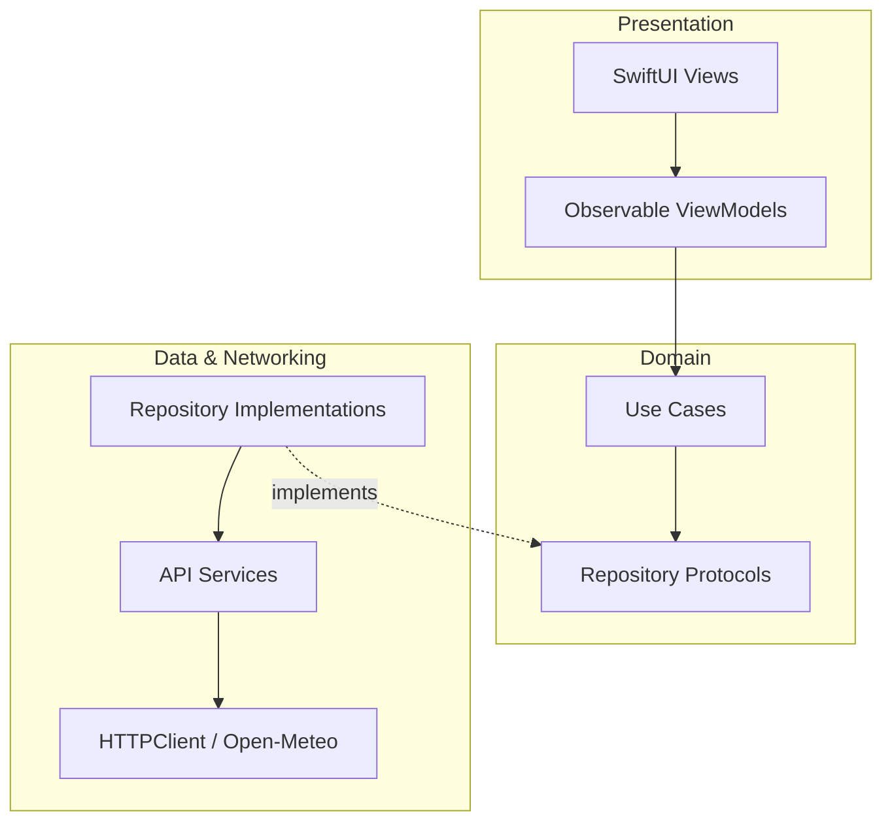

# Weather Activities

A native iOS app that recommends activities for a selected city using the next seven days of weather forecasts.

## Overview

Users can search for a city, choose a matching location, and view four activities ranked by weather suitability:

- Skiing
- Surfing
- Outdoor sightseeing
- Indoor sightseeing

Each recommendation includes a score, a recommended day, and a short explanation. City search and forecasts use the Open-Meteo APIs.

## Tech Stack

- Swift and SwiftUI
- MVVM with Clean Architecture principles
- Swift Concurrency (`async`/`await`) and Observation (`@Observable`)
- URLSession and XCTest
- Point-Free `SnapshotTesting` and `InlineSnapshotTesting` (test target only, via Swift Package Manager)

The app itself has no third-party runtime dependencies; the snapshot libraries are used only in tests.

## Architecture

The app uses lightweight Presentation, Domain, Data, and Networking layers within one Xcode target.

### Architecture Decisions

- **Presentation:** SwiftUI views render UI and handle interactions. Observable ViewModels manage explicit idle, loading, results, empty, and error states.
- **Domain:** Use cases own validation and activity-ranking logic. They depend on repository protocols, not networking implementations.
- **Data:** Repository implementations map API DTOs to domain models.
- **Networking:** API services build requests and decode responses through an injectable HTTP client.

The `DependencyContainer` creates and injects concrete dependencies. ViewModels convert domain models into view-specific presentation data.

### Data Flow

**City search:** `CitySearchView → CitySearchViewModel → SearchCitiesUseCase → CityRepository → CityService`

**Recommendations:** `ActivityRecommendationsView → ActivityRecommendationsViewModel → GetActivityRecommendationsUseCase → WeatherRepository → ForecastService`

The flow from network response to UI is **DTO → Domain → Presentation model**. These boundaries support focused unit tests.

## Build and Run

Requirements: macOS with Xcode, an iOS Simulator, and an iOS 17+ deployment target.

1. Clone the repository and open `WeatherActivities.xcodeproj` in Xcode.
2. Select the `WeatherActivities` scheme and an iOS Simulator.
3. Press **Cmd + R** to build and run.

The public Open-Meteo endpoints used here do not require an API key.

## Testing

The XCTest suite covers:

- City search validation, API decoding, and DTO-to-domain mapping.
- Forecast decoding, repository mapping, and inconsistent response data.
- Activity scoring, ordering, recommended-day selection, and missing data.
- ViewModel success, empty, and failure states.
- Inline snapshot assertions for the ordering and presentation text of mock city search results.
- A SwiftUI city search screen snapshot using a mock use case and a stored reference image.

Tests inject mock HTTP clients, services, repositories, or use cases as appropriate. Unit tests do not rely on live API responses.

`CitySearchViewModelTests` uses `InlineSnapshotTesting` to compare readable text directly in the test source. `CitySearchSnapshotTests` uses `SnapshotTesting` to compare a rendered SwiftUI screen against an image baseline. Image snapshots should be recorded and verified with a consistent simulator and iOS runtime; reference images should be committed alongside the tests.

**Run tests:** Open the project in Xcode and press **Cmd + U**.

## API Usage

Two Open-Meteo endpoints are used:

- **[Geocoding API](https://open-meteo.com/en/docs/geocoding-api):** Searches cities and returns names, countries, regions, coordinates, and time zones.
- **[Forecast API](https://open-meteo.com/en/docs):** Retrieves seven daily forecasts for the selected coordinates and time zone.

Forecast fields include maximum/minimum temperature, precipitation, precipitation probability, snowfall, maximum wind speed, and weather condition code.

## Activity Recommendation Logic

A deterministic algorithm scores each activity from **0 to 100** using relevant weather conditions:

| Activity | Main factors |
| --- | --- |
| Skiing | Snowfall, temperature, wind |
| Surfing | Wind, temperature, precipitation |
| Outdoor sightseeing | Comfortable temperature, low precipitation, wind |
| Indoor sightseeing | Rain, strong wind, extreme temperatures |

For each activity, the use case scores up to seven forecast days and selects the highest-scoring day. An equal score favours the earlier date. It then sorts all four recommendations from highest to lowest score and generates a brief explanation.

The scoring weights are initial, explainable heuristics rather than scientifically validated activity or safety ratings.

## Assumptions and Limitations

- Scores reflect **relative weather suitability**, not guaranteed activity availability.
- The selected city's time zone is passed to the Forecast API.
- Missing fields are handled without crashing; insufficient data may produce a zero score.
- **Skiing:** New snowfall does not establish current snow cover, resort opening, or slope safety.
- **Surfing:** Scores use weather only. Wave height, swell, and coastal suitability are not assessed; a high weather score does not confirm surfable conditions. The [Marine API](https://open-meteo.com/en/docs/marine-weather-api) could improve this later.

## Trade-offs

The implementation favours clear responsibilities, testable business logic, and a simple native UI within the assessment's limited scope.

- **Configuration:** Public API endpoints are defined in the services; separate environment configurations are unnecessary for this prototype.
- **Dependency injection:** A central `DependencyContainer` is used instead of creating a factory abstraction for every type.
- **Search:** An explicit Search action avoids frequent API calls; debounced instant search is deferred.
- **Ranking:** Simple, documented scoring rules are preferred over a complex prediction model.
- **Testing and UI:** Unit tests cover domain and state behaviour, with one focused screen snapshot and an inline snapshot. Extensive UI automation, broader snapshot coverage, and custom animations are deferred.
- **Test development:** I did not follow a strict test-first TDD cycle for this time-boxed implementation. Tests were added to verify the key business rules, mapping, and presentation states.
- **SwiftUI previews:** Additional `#Preview` scenarios for loading, results, empty, and error states, including light/dark appearance, would speed up visual review. Previews complement automated snapshot and UI tests but do not replace them.
- **Git workflow:** Branching was kept lightweight for the assessment. For a team, I would keep `main` (or `master`) production-releasable, use `develop` for integration where useful, and short-lived `feature/*`, `fix/*`, `docs/*`, `release/*`, and `hotfix/*` branches. Urgent hotfixes would branch from production, be merged into production and back into `develop`, with release tags created on validated production-branch commits.

Pull-to-refresh is implemented for loaded recommendations; a failed refresh preserves the previous results and presents an alert. Persistent offline caching and further visual polish remain optional enhancements rather than core requirements.

## Production Readiness

For a production version, I would consider:

- **Configuration:** Typed endpoint configuration and Development, Staging, and Production build settings where distinct environments exist.
- **Architecture:** Feature-specific factories only if the dependency graph grows significantly.
- **Accessibility and devices:** Broader VoiceOver, Dynamic Type, iPad, orientation, and screen-size testing.
- **Search UX:** Debouncing, cancellation of superseded requests, and improved retry behaviour.
- **Quality:** CI builds, static analysis, expanded snapshot/UI test coverage, and measured coverage of important logic (with an aspirational target above 80%).
- **Observability:** Analytics and crash reporting, with any session-recording SDK evaluated for privacy and consent implications.
- **Security:** Keychain storage for any future user credentials or tokens, no committed credentials, and no server-side secrets embedded in the app.
- **Reliability:** Persistent forecast caching, offline fallback, refresh with cache invalidation, and structured diagnostics.

## Cross-Platform Delivery

An Android implementation could use Jetpack Compose, ViewModels with StateFlow, Kotlin Coroutines, repository interfaces, Retrofit or Ktor, and JUnit tests. The API contracts and scoring rules could be reproduced across platforms. Kotlin Multiplatform could be assessed if the product grew enough to justify shared domain logic.

## AI Usage Disclosure

AI assistance was used for code review, implementation suggestions, unit test cases, and documentation. Implementation decisions, integration, and final verification remain my responsibility.

## Data Attribution

Weather and geocoding data are provided by [Open-Meteo](https://open-meteo.com/). See its [licensing and attribution requirements](https://open-meteo.com/en/license).
